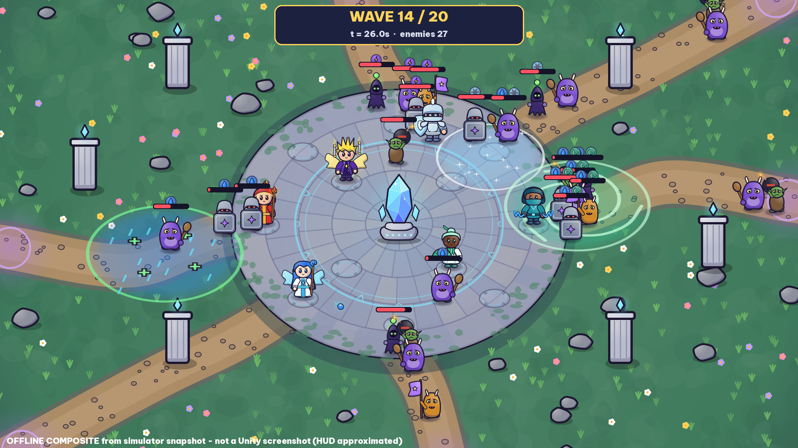

# Aetherward

Auto-battler / crystal defense roguelike 2D (Unity **6000.4.8f1**, Windows · Android · iOS). Tối đa 6 anh hùng quanh một Pha Lê, 6 nguyên tố, 15 phản ứng, 20 đợt, draft/cửa hàng/di vật/tiến hoá/khế ước. Trận đấu tự động; chiến thuật nằm ở đội hình và lựa chọn giữa các đợt.



*Ảnh trên là **composite offline**: trạng thái thật từ bộ mô phỏng, vẽ bằng sprite thật ở đúng tỉ lệ camera — không phải ảnh chụp Unity (dự án chưa được mở trong Unity Editor trong phiên này).*

## Trạng thái
- **Đã kiểm chứng:** lớp mô phỏng gameplay (64 test PASS), 180 lượt mô phỏng đủ 20 đợt không kẹt, toàn bộ script Unity/Editor type-check 0 lỗi với DLL tham chiếu Unity, nội dung + bản dịch EN/VI được validator kiểm tra.
- **Chưa kiểm chứng:** chạy trong Unity Editor, build Windows/Android/iOS, hiệu năng trên thiết bị, cảm giác chơi thực tế. Xem `Docs/ENVIRONMENT_AUDIT.md`.

## Bắt đầu
1. Mở thư mục repo bằng Unity 6000.4.8f1.
2. Menu **Aetherward > Validate Content and Art**.
3. Menu **Aetherward > Play From Boot** (hoặc mở `Assets/_Aetherward/Scenes/Boot.unity` rồi Play).
4. Build: **Aetherward > Build > …** (chi tiết `Docs/BUILD.md`).

Điều khiển: kéo-thả hoặc chạm anh hùng rồi chạm ô; Space = bắt đầu đợt; F = 1×/2×; Esc = tạm dừng; F3 = hiện tầm đánh. Mọi thao tác đều làm được bằng chạm.

## Tài liệu
| File | Nội dung |
|---|---|
| `Docs/GDD.md` | Thiết kế trò chơi |
| `Docs/ARCHITECTURE.md` | Kiến trúc, ranh giới module, công thức |
| `Docs/CONTENT_CATALOG.md` | Mọi ID nội dung → cơ chế (sinh từ dữ liệu) → art → test |
| `Docs/BALANCE.md`, `Docs/Balance/` | Công thức, kết quả mô phỏng, hiệu năng |
| `Docs/TEST_PLAN.md` | Test tự động + checklist thủ công |
| `Docs/BUILD.md` | Mở project, build, công cụ |
| `Docs/DECISIONS.md` | Các quyết định và lý do |
| `Docs/ASSET_LICENSES.md`, `Docs/ASSET_MANIFEST.json` | Nguồn gốc/giấy phép asset |
| `Docs/ART_DIRECTION.md`, `Docs/Previews/` | Định hướng hình ảnh, contact sheet |
| `Docs/REPORT_VI.md` | Báo cáo bàn giao |

## Kiểm thử ngoài Unity
```
cd Tools/SimHarness
dotnet test Tests
dotnet run --project Balance -c Release -- --runs 30
```
